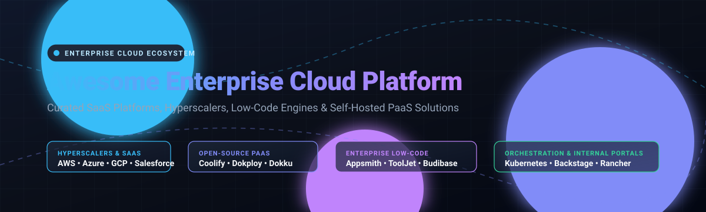

# ☁️ Awesome Enterprise Cloud Platform

  

  
  
  
  
  
  
  

---

## 🧭 Top Enterprise Cloud Platform Ecosystem

> **A curated discovery directory of industry-leading enterprise SaaS platforms, hyperscale clouds, low-code application suites, and production-grade self-hosted open-source PaaS alternatives.**

Enterprise cloud platforms represent the core operating backbones for modern Fortune 500 corporations, agile digital enterprises, and high-growth engineering teams. Spanning compute infrastructure, serverless runtimes, composable low-code app generation, and complex workflow automation, selecting the optimal combination of hosted hyperscalers and sovereign open-source toolchains is critical for agility, compliance, and total cost of ownership (TCO).

---

## 📑 Table of Contents

- [📊 Sector Overview & Market Dynamics](#-sector-overview--market-dynamics)
- [🏢 Enterprise SaaS & Hyperscale Cloud Platforms](#-enterprise-saas--hyperscale-cloud-platforms)
- [🔓 Open-Source GitHub Projects](#-open-source-github-projects)
  - [🚀 Self-Hosted PaaS, Container & Cloud Infrastructure](#-self-hosted-paas-container--cloud-infrastructure)
  - [⚡ Low-Code Application Platforms & Tool Builders](#-low-code-application-platforms--tool-builders)
  - [💼 Enterprise Application Frameworks & ERPs](#-enterprise-application-frameworks--erps)
- [📈 Star History](#-star-history)
- [💖 Support & Sponsorship](#-support--sponsorship)
- [🤝 How to Contribute](#-how-to-contribute)
- [⚖️ Disclaimer](#️-disclaimer)

---

## 📊 Sector Overview & Market Dynamics

The global enterprise cloud platform and cloud computing market is estimated at **$676 Billion in 2024** and projected to exceed **$2.2 Trillion by 2032**, expanding at a robust compound annual growth rate (CAGR) of ~16.5%. 

The sector exhibits **high structural concentration (oligopolistic / winner-take-most dynamics)** at the core infrastructure layer (IaaS/PaaS)—dominated by the hyperscaler triumvirate of Amazon Web Services (AWS), Microsoft Azure, and Google Cloud Platform (GCP). In contrast, the application platform, workflow orchestration, and low-code enablement tier displays **moderate fragmentation**, where specialized enterprise champions (Salesforce, ServiceNow, SAP BTP, Workday) compete alongside a thriving wave of sovereign, self-hostable open-source frameworks (Kubernetes, Coolify, Backstage, Appsmith) addressing multi-cloud autonomy, compliance, and developer independence.

---

## 🏢 Enterprise SaaS & Hyperscale Cloud Platforms

The table below catalogs premier enterprise cloud providers and hosted enterprise platforms, sorted in descending order by enterprise corporate valuation / market capitalization.

| SaaS / Cloud Platform | Corporate Scale (Market Cap / Valuation) | Starting Pricing (Specific Entry Tier) | Free Tier / Trial Allowance | Core Architectural Strengths |
| :--- | :--- | :--- | :--- | :--- |
| **[Microsoft Azure](https://azure.microsoft.com/)** | **~$3.10 Trillion** (Market Cap) | Pay-as-you-go; B1s burstable Linux VM at **$0.0104/hour** (~$7.50/month) | **12 months free** of 55+ services (including 750 hrs B1s VM, 64 GB storage) + **$200 credit** for 30 days + 55+ services always free | Hyperscale cloud leader excelling in native Windows/Active Directory hybrid integration, enterprise governance, and Azure OpenAI Service integrations. |
| **[AWS (Amazon Web Services)](https://aws.amazon.com/)** | **~$2.05 Trillion** (Amazon Market Cap) | Pay-as-you-go; t4g.nano EC2 instance at **$0.0042/hour** (~$3.02/month) | **12 months free** (750 hrs/mo t2.micro or t3.micro EC2, 5 GB S3 standard storage, 750 hrs RDS) + 1M AWS Lambda requests/mo always free | Industry pioneer offering unmatched depth (200+ fully featured services), high availability regions, and broad enterprise ecosystem support. |
| **[Google Cloud Platform (GCP)](https://cloud.google.com/)** | **~$2.00 Trillion** (Alphabet Market Cap) | Pay-as-you-go; e2-micro instance at **$0.0084/hour** (~$6.11/month) | **Always-Free Tier** with 1 e2-micro VM/mo (US regions, 30 GB disk) + 5 GB Cloud Storage + **$300 free credits** valid for 90 days across all services | Leading AI/ML platform (Vertex AI, BigQuery, Gemini models), Kubernetes-native ergonomics (GKE), and premier data engineering pipelines. |
| **[Oracle Cloud Platform (OCI)](https://www.oracle.com/)** | **~$480 Billion** (Market Cap) | Pay-as-you-go; OCI Ampere A1 Compute starting at **$0.01/OCPU-hour**; APEX Application Development at **$115/month** | **Always Free** tier with 4 Ampere A1 OCPUs & 24 GB RAM (up to 4 VMs) + 2 Autonomous Databases (20 GB each) + **$300 free credits** for 30 days | Ultra-high performance database infrastructure (Exadata), cost-effective Arm compute architecture, and native zero-latency Oracle APEX low-code development. |
| **[SAP Business Technology Platform](https://www.sap.com/)** | **~$280 Billion** (Market Cap) | Pay-as-you-go starting tier; SAP Build Work Zone Standard Edition at **$0.12/active user/month** | **Free Tier Model** (always-free access within SAP BTP enterprise accounts for selected services like SAP HANA Cloud up to 32 GB, SAP Build) + 90-day trial | Deep integration with SAP ERP (S/4HANA), Joule enterprise AI agent runtime, and robust composable business workflow orchestrations. |
| **[Salesforce Platform](https://www.salesforce.com/)** | **~$270 Billion** (Market Cap) | **$25/user/month** (Starter Suite, billed annually) | **30-day full-access free trial** (unrestricted access to Lightning Platform, standard CRM objects, Flow automation, no credit card required) | Metadata-driven enterprise application architecture, Lightning App Builder, Data Cloud integration, and Agentforce autonomous enterprise agent orchestration. |
| **[ServiceNow Now Platform](https://www.servicenow.com/)** | **~$190 Billion** (Market Cap) | Custom enterprise licensing starting at **~$100/user/month** (Standard package tier) | **Personal Developer Instance (PDI)**: Completely free perpetual sandbox instance with full platform admin capabilities, API access, and Now Assist AI capabilities | Universal IT, HR, and customer service digital workflows; Now Assist AI Agent Orchestrator with App Engine Studio for cross-enterprise app composition. |
| **[IBM Cloud](https://www.ibm.com/cloud)** | **~$190 Billion** (Market Cap) | Pay-as-you-go; shared virtual server instance starting at **$0.012/hour** (~$8.75/month) | **IBM Cloud Lite** account: Perpetual free tier with 256 MB Cloud Foundry memory, 1 Lite cluster on Red Hat OpenShift, IBM Watsonx Lite tier (10K tokens/mo) | Mission-critical hybrid-cloud security, confidential computing, Red Hat OpenShift managed orchestration, and watsonx enterprise AI governance. |
| **[Workday Platform](https://www.workday.com/)** | **~$65 Billion** (Market Cap) | Enterprise subscription starting at approximately **~$45/user/month** (Core HCM tier, multi-year agreement) | **30-day interactive guided demo sandboxes** and developer test environments for registered partner/customer platform evaluations | Unified single-data-model enterprise management cloud for financial planning, human capital management (HCM), and native Workday Extend app extensions. |
| **[Microsoft Power Platform](https://powerplatform.microsoft.com/)** | Included under Microsoft Valuation | **$5/user/month** (Power Apps per-app plan; or $20/user/month for unlimited Power Apps) | **Power Apps Developer Plan**: Permanent free developer environment for individual building and testing with Dataverse and premium connectors included | Ubiquitous citizen-developer and pro-code suite (Power Apps, Power Automate, Copilot Studio, Dataverse) with seamless Microsoft 365 and Azure bridges. |

---

## 🔓 Open-Source GitHub Projects

The open-source enterprise cloud ecosystem empowers teams to eliminate vendor lock-in, host sovereign PaaS clouds on bare metal or colocation facilities, and orchestrate low-code applications without recurring per-seat penalties.

Every repository is listed below and sorted strictly by **GitHub Star Count (descending)**, with direct links to stargazers.

### 🚀 Self-Hosted PaaS, Container & Cloud Infrastructure

*Production-grade deployment platforms, cloud operating systems, and container orchestrators.*

- **[Kubernetes](https://github.com/kubernetes/kubernetes)**   
  *Production-Grade Container Orchestration.* The de facto open-source infrastructure standard for automating deployment, scaling, and operational management of containerized workloads across private clusters and multi-cloud footprints.

- **[Coolify](https://github.com/coollabsio/coolify)**   
  *An open-source & self-hostable Heroku / Netlify / Vercel alternative.* Deploys applications, databases, and services to any Linux server or VPS with built-in SSL, webhooks, zero-downtime deployments, and push-to-deploy Git workflows.

- **[Dokploy](https://github.com/Dokploy/dokploy)**   
  *Effortless deployment and management platform.* Modern, developer-centric self-hosted PaaS powered by Docker and Traefik, providing automated SSL certificates, multi-server management, databases, and Docker Compose orchestration.

- **[Backstage](https://github.com/backstage/backstage)**   
  *An open platform for building developer portals.* Originally conceived by Spotify and donated to CNCF, Backstage unifies internal tooling, software cataloging, service templates, and technical documentation into a centralized enterprise platform.

- **[k3s](https://github.com/k3s-io/k3s)**   
  *Lightweight Kubernetes.* Highly available, certified Kubernetes distribution engineered by Rancher/SUSE for IoT, Edge computing, bare-metal enterprise appliances, and resource-constrained environments.

- **[Dokku](https://github.com/dokku/dokku)**   
  *A docker-powered PaaS that helps you build and manage the lifecycle of applications.* The smallest and most enduring PaaS implementation in existence; enables simple `git push dokku main` deployment mechanisms with rich plugin extensibility.

- **[OpenFaaS](https://github.com/openfaas/faas)**   
  *Serverless Functions Made Simple.* Enterprise-ready serverless function and microservice framework running on Kubernetes and Docker Swarm with auto-scaling, Prometheus metrics, and native multi-language templates.

- **[Rancher](https://github.com/rancher/rancher)**   
  *Complete container management platform.* Enterprise Kubernetes management orchestration engine providing unified multi-cluster RBAC, compliance policies, cluster provisioning (EKS, GKE, AKS, bare-metal), and full lifecycle monitoring.

- **[CapRover](https://github.com/caprover/caprover)**   
  *Scalable PaaS built on Docker and Nginx.* Often called "Heroku on Steroids", CapRover deploys apps and databases in seconds with one-click app templates, automatic SSL via Let's Encrypt, and CLI automation.

- **[UbiCloud](https://github.com/ubicloud/ubicloud)**   
  *Open-source alternative to AWS.* Delivers cloud primitives (compute, block storage, load balancers, managed PostgreSQL, and managed Kubernetes) directly on top of bare-metal servers, offering substantial cloud cost reductions.

- **[OpenKruise](https://github.com/openkruise/kruise)**   
  *Automate application management on Kubernetes.* CNCF incubating project providing enterprise-grade application deployment, in-place container updates, progressive canary rollouts, and advanced high-availability workload controllers.

- **[Kubero](https://github.com/kubero-dev/kubero)**   
  *Self-hosted PaaS running natively on Kubernetes.* Lightweight developer platform converting Kubernetes clusters into internal application delivery engines with GitOps deployment workflows, staging branches, and metrics.

- **[Cloud Foundry Cloud Controller](https://github.com/cloudfoundry/cloud_controller_ng)**   
  *The heart of Cloud Foundry.* Proven open-source enterprise PaaS orchestration controller powering high-volume enterprise app runtimes, org/space multi-tenancy, and polyglot buildpacks.

---

### ⚡ Low-Code Application Platforms & Tool Builders

*Rapid internal app builders, drag-and-drop workflow engines, and business tool platforms.*

- **[ToolJet](https://github.com/ToolJet/ToolJet)**   
  *Low-code platform for building enterprise internal applications.* Connects seamlessly to databases (PostgreSQL, MongoDB, Snowflake), cloud storage, and REST/GraphQL APIs with an extensible React-based canvas and AI-assisted workflows.

- **[Appsmith](https://github.com/appsmithorg/appsmith)**   
  *Open-source platform to build admin panels, CRUD apps, and workflows.* Features robust role-based access control (RBAC), Git-based versioning, JavaScript code bindings, and pre-built widgets for mission-critical enterprise utilities.

- **[Budibase](https://github.com/Budibase/budibase)**   
  *Open-source low-code platform for enterprise applications.* Enables developers and IT teams to transform SQL/NoSQL databases into secure portals, forms, and automated business workflows with self-hosted Docker and Kubernetes helm charts.

- **[NocoBase](https://github.com/nocobase/nocobase)**   
  *Extensibility-first, open-source no-code / low-code platform.* Features a microkernel architecture where all capabilities are implemented as modular plugins, providing granular permission models and visual data modeling.

- **[Lowcoder](https://github.com/lowcoder-org/lowcoder)**   
  *Open-source alternative to Retool and ToolJet.* Self-hostable rapid application development environment for internal tooling, supporting custom component plugins, granular audit logs, and complex SQL/API query chains.

- **[Convertigo](https://github.com/convertigo/convertigo)**   
  *Full-stack enterprise low-code / no-code platform.* Offers mobile and web application builders, offline data synchronization, enterprise backend connector adapters, and integrated MBaaS runtime engines.

---

### 💼 Enterprise Application Frameworks & ERPs

*Comprehensive enterprise operational frameworks, metadata-driven CRMs, and modular business suites.*

- **[Twenty](https://github.com/twentyhq/twenty)**   
  *The open-source CRM alternative to Salesforce.* Built with TypeScript, GraphQL, and modern web primitives; delivers custom object modeling, relational data views, and modular workspace extensions with full data sovereignty.

- **[Odoo](https://github.com/odoo/odoo)**   
  *Comprehensive suite of business and enterprise software tools.* Python-based modular enterprise platform encompassing CRM, Point of Sale, Website/eCommerce, Manufacturing (MRP), Inventory, Accounting, and HR automation.

- **[Frappe Framework](https://github.com/frappe/frappe)**   
  *Full-stack, low-code web application framework.* The bedrock architecture powering ERPNext, featuring declarative schema definitions (DocTypes), built-in authentication, background job queues, and responsive desk interfaces.

- **[Apache OFBiz](https://github.com/apache/ofbiz-framework)**   
  *Enterprise automation software suite.* Mature Java-based suite of business applications and integration services providing robust frameworks for ERP, supply chain, warehouse management, and accounting.

- **[iDempiere](https://github.com/idempiere/idempiere)**   
  *Community-driven open-source ERP / CRM / SCM.* OSGi-based enterprise resource planning platform engineered for international compliance, complex inventory costing, multi-organization accounting, and extensible plug-in architectures.

---

## 📈 Star History

---

## 💖 Support & Sponsorship

If you find this curated enterprise cloud repository helpful in architecting your organization's cloud strategy or discovering open-source alternatives, please consider:

- ⭐ **Starring this repository** to help others discover it across GitHub.
- 🍴 **Forking and sharing** with your engineering, DevOps, and cloud architecture networks.
- ☕ **Sponsoring the project** to fuel continuous updates, deep dives, and maintenance:
  
  

Every contribution and star is deeply appreciated! 🚀

---

## 🤝 How to Contribute

Contributions from cloud architects, DevOps engineers, and platform builders are welcome!

1. 🍴 **Fork** this repository.
2. 🌿 Create a descriptive feature branch (`git checkout -b feature/add-new-cloud-platform`).
3. 📝 Add or update entries according to the established structure (ensure specific pricing/tier metrics, star badges, and official links).
4. 📬 Submit a clean Pull Request with a succinct explanation of the changes.

Please consult [Awesome-Awesome-Awesome](https://github.com/ishandutta2007/Awesome-Awesome-Awesome) for complementary curated enterprise software lists.

---

## ⚖️ Disclaimer

- This list is **community-curated** for architectural discovery, benchmark comparison, and research purposes—it does not constitute an official product endorsement.
- All brand names, product titles, logos, and registered trademarks belong to their respective corporate owners (AWS, Microsoft, Google, Oracle, SAP, Salesforce, ServiceNow, Workday, IBM, etc.).
- Ensure adherence to enterprise compliance frameworks (SOC 2, ISO 27001, HIPAA, GDPR) and verify software license models (MIT, Apache-2.0, AGPL-3.0) prior to commercial production deployment.
- Star statistics and market metrics reflect public disclosures and live GitHub API data as of October 2026.
